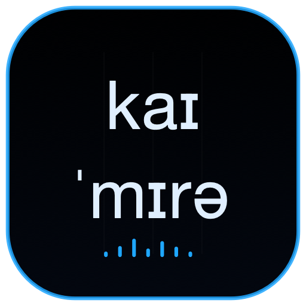

<p align="center">
  
</p>

<h1 align="center">CHIMERA</h1>

<p align="center">
  <a href="https://www.rust-lang.org/"></a>
  <a href="https://developer.apple.com/swiftui/"></a>
  <a href="https://bun.sh/"></a>
  <a href="LICENSE"></a>
</p>

A physical-modeling voice synthesizer in the browser. Every sound comes from a simulated
airway (lungs, vocal folds or syrinx, a branched vocal tract, lips, nose), not from samples.
The engine is Rust, compiled to WebAssembly for an AudioWorklet; the same code runs natively
for tests and the `chimera` CLI.

## What it does

- **Play**: drag the tongue, lips and jaw in a live cutaway of the head; vowel pad, encoders,
  computer keyboard and Web MIDI.
- **Speak**: English text (CMUdict with a letter-to-sound fallback) or IPA, turned into
  gestures and prosody, with the gestural score and a consonant chart on screen.
- **Sing**: piano roll with lyrics per note; consonants land before the beat.
- **Beatbox**: pads and a step sequencer, every drum an articulatory gesture.
- **Bestiary**: songbird (two-voice syrinx), seal, alligator and elephant.
- **Duet** (`?show=<id>`): two 3D heads replay a pre-rendered song.

Male, female and child bodies blend continuously. Everything on screen animates from live
engine state: pressure in the airway, airflow, the vocal folds, spectra and formants.

## Run it

Needs Rust with the `wasm32-unknown-unknown` target, and Bun.

```sh
bun install
bun run dev        # builds the wasm, then Vite on 127.0.0.1:5317
bun run test       # wasm build, cargo test --workspace, bun test tests
```

The AudioWorklet needs a secure context, so open it on localhost or over HTTPS (for example
`tailscale serve`). Vercel builds it with `vercel.json`.

## Native macOS

The `native/` SwiftUI apps link the Rust engine directly through its C ABI; no WebView, WebAssembly runtime or samples are used. XcodeGen generates the combined debug shell and seven independent application targets:

| Scheme / product | Bundle ID | MCP | Scope |
|---|---|---:|---|
| `ChimeraMac` / Chimera | `org.chimera.vocal-synth` | 8642 | Combined debug shell with all existing modes |
| `ChimeraPlay` / Chimera Play | `org.chimera.play` | 8643 | Remote source/articulation controls, continuous F1/F2 vowel map, shared CoreMIDI/piano input and Start/Stop |
| `ChimeraSpeak` / Chimera Speak | `org.chimera.speak` | 8644 | Ollama prompt chat, generated-reply speech, gestural score, layered spectrogram and expandable acoustic views |
| `ChimeraSing` / Chimera Sing | `org.chimera.sing` | 8645 | Editable piano roll, per-note lyrics, presets, CoreMIDI/piano input, Ollama lyrics, remote transport and shared acoustic views |
| `ChimeraBeatbox` / Chimera Beatbox | `org.chimera.beatbox` | 8646 | Remote presets, editable beat text, synchronized 16-step matrix, OP-1 transport knobs, press-to-hit pads and 1–0 keyboard control |
| `ChimeraHead` / Chimera Head | `org.chimera.head` | 8647 | Exclusive audio/model/3D host, physical airflow particles, spring head motion, local camera, telemetry stream and optional LKG output |
| `ChimeraGenderAge` / Chimera Gender Age | `org.chimera.gender-age` | 8648 | Continuous BodyMix, six voice/articulation pages, Hold Breath and persistent all-controller Whisper |
| `ChimeraViewer` / Chimera Viewer | `org.chimera.viewer` | 8649 | Pure remote gestural score, full consonants, tube, vocal folds and layered spectrogram |

All MCP services listen only on the loopback interface at `http://127.0.0.1:<port>/mcp`. Each app has its own `@main`, view, product name, window size and bundle identifier, so all seven independent apps can run together. Head owns the only independent-app `AudioController` / `AVAudioEngine`; controllers do not create audio outputs or duplicate the 3D head. The combined `ChimeraMac` debug shell retains its own local engine.

The native app icons use each app's IPA phonemes in the shared dark vector style: Play `pleɪ`, Speak `spiːk`, Sing `sɪŋ`, Beatbox `biːt/bɑks`, Head `hɛd`, Viewer `vjuːə` and Chimera `kaɪ/ˈmɪrə`. Gender Age uses `eɪdʒ` above blue/pink gender symbols. Regenerate every macOS size with `DEVELOPER_DIR=/Applications/Xcode.app/Contents/Developer swift native/Tools/GenerateIcons.swift`; each app's `Assets.xcassets` is included by its existing target sources.

Needs Xcode, Rust and XcodeGen. Head also resolves the `StreamQuilt` Swift package for optional Looking Glass output:

```sh
cd native
xcodegen generate
for scheme in ChimeraMac ChimeraPlay ChimeraSpeak ChimeraSing ChimeraBeatbox ChimeraHead ChimeraGenderAge ChimeraViewer; do
  DEVELOPER_DIR=/Applications/Xcode.app/Contents/Developer \
    xcodebuild -project ChimeraMac.xcodeproj -scheme "$scheme" -configuration Release -derivedDataPath build
done
open build/Build/Products/Release/Chimera\ Head.app
open build/Build/Products/Release/Chimera\ Play.app
```

Every target copies the existing `public/data/cmudict.txt.gz` and expands it to `Contents/Resources/cmudict.txt`; native pronunciation must not silently fall back to letter-to-sound because the dictionary is absent. Play and Sing share `MIDIInputController` and `MIDIInputView` for CoreMIDI note-on/off input.

If Xcode reports a missing Metal compiler, run `xcodebuild -downloadComponent MetalToolchain` once.

Head publishes NDJSON at `GET http://127.0.0.1:8647/head/stream`. Shared `HeadTelemetryFrame` Codable data includes `source="head"`, instance/project identity, `timestamp`, `Body`, `HumanArtic`, `HumanFrame`, `VoiceTelemetry`, `playing`, `active`, `beatStep` (`-1` when unavailable), `beatPlaying`, `engineRunning`, `renderedFrames` and `whisperEnabled`. Acoustic messages run at about 30 Hz and geometry is refreshed at 10 Hz on the main-side timer, never in the audio render callback. Controllers reconnect to this stream automatically instead of polling MCP for telemetry.

Play's vowel map uses the same continuous model as the web UI: calibrated vowel articulations blend with the current Body, and dragging in log F1/F2 space interpolates the nearest four vowels by inverse distance. Ordered loopback commands coalesce pending articulation/source/Body updates so Head applies only the latest values. Body model and geometry rebuilds are coalesced separately from UI updates; the same audio host and gate remain alive across Body edits and controller reconnects.

Speak's chat box accepts only Ollama user prompts; the prompt itself is never spoken. Enter submits, Shift+Enter inserts a newline. A new submission stops the previous utterance and supersedes any earlier generation. Only Ollama's generated reply is validated as plain English and spoken immediately through Head. Generation errors remain in the conversation and never send empty text. Each assistant reply has a Play button that replays only that generated text through Head, superseding earlier generation/speech. Stop cancels generation/speech and Clear resets the current session. Direct English/IPA remains available through the non-chat `chimera_speak` MCP API. Ollama must run on `127.0.0.1:11434`.

Sing edits real MIDI pitch/start/duration values in a selectable, draggable and resizable piano roll. Every note carries one validated engine syllable; missing or ambiguous lyrics block playback with an explicit error. Presets and edited scores use Head's existing `planSong`, preserving early consonants, sustained vowels, codas, releases and melisma. CoreMIDI and the on-screen piano sing successive syllables through `planNoteOn`/`planNoteOff`. Ollama prompts are writing instructions only: only validated generated English lyrics are assigned to notes. Play replaces the old song after Stop, pending replacement requests coalesce, and the playhead/current syllable follow Head's NDJSON clock. Gestural Score and the layered two-second Spectrogram are visible by default; Tube and Vocal Folds are expandable. The full consonant chart remains in Viewer. `chimera_sing` supports set/play/generate/stop and note-on/note-off; `chimera_stop_singing` stops only the current song.

Head's Metal renderer matches the Retina drawable, uses multisample and line-edge antialiasing, restrained glow and core-line depth writes. Physical particles use local `flow / area`, follow the oral/nasal geometry and reset on Body changes or clock seeks. Speech drives small spring-smoothed model motion without moving the user's camera. Animation and particles have independent switches and never touch the audio callback or articulation plan.

For LKG Go, Head enters Looking Glass Bridge orchestration and reads the actual device's calibration and `defaultQuilt`; it does not use fallback calibration. The same Head visual snapshot is rendered through an independent parallel camera array, interlaced with StreamQuilt and shown in a separate window. Local Head yaw/pitch/zoom are mirrored to LKG, while FOV, Focus distance and Parallax sliders control only the LKG camera array. The startup optical defaults are 51° FOV, 47 cm Focus and 20 cm Parallax; ranges are 12–90°, 20–100 cm and 0–30 cm respectively. The optical controls are also available through `head_lkg_camera`. Quilt color/depth and particle history are cleared correctly across frames and Body changes. Connect/disconnect and Bridge failure do not stop audio, MCP or NDJSON. `head_status` reports LKG connection, rendered frames and whether real hardware frames have completed; a static image is not hardware validation.

Head advertises `head_status`, `head_select_source`, `head_set_camera`, `head_set_visuals`, `head_lkg` and `head_lkg_camera`, plus the shared sound controls. Play forwards note/start/voice/gate controls to Head. Speak forwards `chimera_speak` and `chimera_stop_speech`; Beatbox forwards `chimera_beatbox` play/stop/hit/set commands, including the latest step matrix and grouped BPM/Swing transport values. For example:

```sh
curl -s http://127.0.0.1:8643/mcp \
  -H 'content-type: application/json' \
  -d '{"jsonrpc":"2.0","id":1,"method":"tools/call","params":{"name":"chimera_play_note","arguments":{"midi":60,"duration":1}}}'
```

Offline renders and measurement:

```sh
cargo run --release -p chimera-cli -- render speech|text|song|notes|beatbox|creature|vowels …
cargo run --release -p chimera-cli -- diagnose       # nasal leakage, formants, bandwidths, pitch
cargo run --release -p chimera-cli -- compare csd    # against a real singer (docs/csd-comparison.md)
bun tools/spectrogram.ts in.wav out.png
```

## Docs

- [docs/architecture.md](docs/architecture.md): the acoustic model (FDTD airway, sources,
  anatomy, gestures).
- [docs/rust-engine.md](docs/rust-engine.md): the engine's real-time and determinism contract,
  and the browser boundary.
- [docs/ui-redesign.md](docs/ui-redesign.md) and [docs/mockups/](docs/mockups/): the vector
  display look.
- [docs/csd-comparison.md](docs/csd-comparison.md): scoring the voice against the Children's
  Song Dataset.
- [docs/hill-climb/](docs/hill-climb/): the rules and log for tuning the voice one measured
  step at a time.

Agents: see [AGENTS.md](AGENTS.md).

## License

[MIT](LICENSE). Bundled third-party files keep their own licenses: the CMU Pronouncing
Dictionary ([public/data/CMUDICT-LICENSE.txt](public/data/CMUDICT-LICENSE.txt)) and the fonts
([public/fonts/](public/fonts/)).
