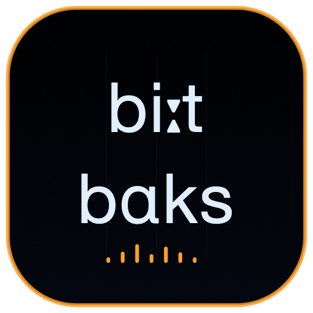

<p align="center">
  
</p>

<h1 align="center">CHIMERA BEATBOX</h1>

<p align="center">
  
  
  
</p>

Beatbox is a remote articulatory drum controller for CHIMERA Head. Every hit is a physical mouth gesture, not a sample.

## Features

- Editable beat notation parsed by the existing engine.
- A synchronized 16-step matrix with live Head playhead.
- Presets, BPM and Swing transport controls.
- Press-to-hit pads and 1–0 keyboard control; editing fields and key repeat are ignored.
- Ordered remote play/stop/hit/set commands with coalesced transport updates.
- Live gate and output-RMS telemetry from Head.

## Identity

| Setting | Value |
|---|---|
| Scheme / product | `ChimeraBeatbox` / Chimera Beatbox |
| Bundle ID | `org.chimera.beatbox` |
| MCP | `http://127.0.0.1:8646/mcp` |
| Audio host | Chimera Head on port 8647 |

## Run

```sh
cd native
xcodegen generate
DEVELOPER_DIR=/Applications/Xcode.app/Contents/Developer xcodebuild -project ChimeraMac.xcodeproj -scheme ChimeraBeatbox -configuration Release -derivedDataPath build
open build/Build/Products/Release/Chimera\ Head.app
open build/Build/Products/Release/Chimera\ Beatbox.app
```

`chimera_beatbox` supports play, stop, hit and set operations, including the latest steps, BPM and Swing values.

[Project license](../../../../LICENSE) · [Main project](../../../../README.md)
