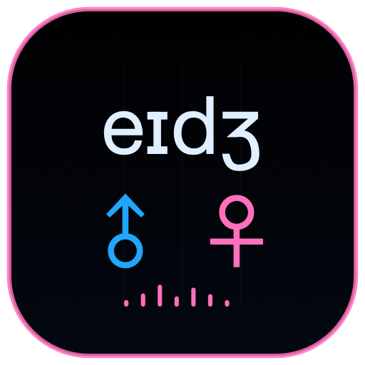

<p align="center">
  
</p>

<h1 align="center">CHIMERA GENDER AGE</h1>

<p align="center">
  
  
  
</p>

Gender Age is the continuous BodyMix and voice-shaping controller for CHIMERA Head. The Logo combines `eɪdʒ` with blue/pink gender symbols rather than spelling the longer project name.

## Features

- Shared triangular Male/Female/Child palette with continuous BodyMix weights.
- Matching outline colors and exact pointer-release application.
- Six real control pages: Voice, Tone, Pitch, Mouth, Tongue and Throat.
- Hold Breath for sustained airflow.
- Persistent Whisper for every Head controller event, including Play, Speak, Sing and Beatbox.
- Whisper state is stored by Head and synchronized to controllers through NDJSON.

Whisper remains active across stop, mode changes and other applications' source updates until explicitly disabled.

## Identity

| Setting | Value |
|---|---|
| Scheme / product | `ChimeraGenderAge` / Chimera Gender Age |
| Bundle ID | `org.chimera.gender-age` |
| MCP | `http://127.0.0.1:8648/mcp` |
| Audio host | Chimera Head on port 8647 |

## Run

```sh
cd native
xcodegen generate
DEVELOPER_DIR=/Applications/Xcode.app/Contents/Developer xcodebuild -project ChimeraMac.xcodeproj -scheme ChimeraGenderAge -configuration Release -derivedDataPath build
open build/Build/Products/Release/Chimera\ Head.app
open build/Build/Products/Release/Chimera\ Gender\ Age.app
```

Use `chimera_set_voice` for BodyMix, source and articulation controls. Its `whisper` boolean controls the persistent global mode.

[Project license](../../../../LICENSE) · [Main project](../../../../README.md)
