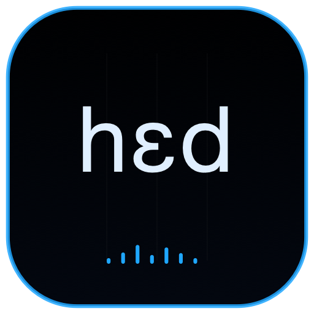

<p align="center">
  
</p>

<h1 align="center">CHIMERA HEAD</h1>

<p align="center">
  
  
  
</p>

Head is the exclusive audio, physical-model and 3D-head host for the independent CHIMERA applications. Controllers never create another `AVAudioEngine` or duplicate the head.

## Features

- One persistent `AudioController` and `AVAudioEngine` for all independent controllers.
- Local 3D vocal tract, physical airflow particles, animation and camera controls.
- NDJSON telemetry at `GET http://127.0.0.1:8647/head/stream`, approximately 30 Hz acoustics and 10 Hz geometry.
- Ordered voice, speech, song and beatbox controls with coalesced continuous updates.
- Persistent Whisper state applied to all controller events.
- Optional Looking Glass output using real Bridge calibration and `defaultQuilt` data.
- LKG startup defaults: 51° FOV, 47 cm Focus and 20 cm Parallax; ranges 12–90°, 20–100 cm and 0–30 cm.
- LKG connection, failure and disconnection remain isolated from audio, MCP and NDJSON.

Start Head before the other applications. It may remain in Standby until the first sounding command.

## Identity

| Setting | Value |
|---|---|
| Scheme / product | `ChimeraHead` / Chimera Head |
| Bundle ID | `org.chimera.head` |
| MCP | `http://127.0.0.1:8647/mcp` |
| Telemetry | `http://127.0.0.1:8647/head/stream` |

## Run

```sh
cd native
xcodegen generate
DEVELOPER_DIR=/Applications/Xcode.app/Contents/Developer xcodebuild -project ChimeraMac.xcodeproj -scheme ChimeraHead -configuration Release -derivedDataPath build
open build/Build/Products/Release/Chimera\ Head.app
```

Head additionally resolves the `StreamQuilt` Swift package. `head_status` reports engine frames, stream clients, camera, LKG state and hardware-frame verification.

[Project license](../../../../LICENSE) · [Main project](../../../../README.md)
