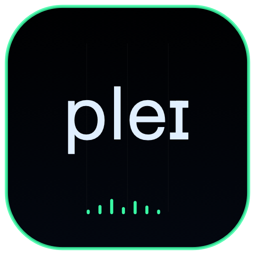

<p align="center">
  
</p>

<h1 align="center">CHIMERA PLAY</h1>

<p align="center">
  
  
  
</p>

Play is the direct remote instrument for CHIMERA Head. It controls the physical voice source, articulators and pitch without creating an audio engine or rendering another 3D head.

## Features

- Continuous F1/F2 vowel map using the shared calibrated `VowelSpace` model.
- Source pitch, pressure, breathiness, tension and vibrato controls.
- Mouth and tongue articulation controls with coalesced remote updates.
- Shared CoreMIDI note input and on-screen piano keys; MIDI starts enabled in Play.
- PolyBrute expression for the monophonic voice, including calibrated Morphée X/Y vowel control and explicit no-MIDI defaults. See the [PolyBrute performance mapping table](../../../../README.md#polybrute-performance-mapping) for controller names, MIDI channels/messages, parameter targets and ranges.
- Live Head gate, F0, lung-pressure and output-RMS telemetry.

## Identity

| Setting | Value |
|---|---|
| Scheme / product | `ChimeraPlay` / Chimera Play |
| Bundle ID | `org.chimera.play` |
| MCP | `http://127.0.0.1:8643/mcp` |
| Audio host | Chimera Head on port 8647 |

## Run

Build and start Head before Play:

```sh
cd native
xcodegen generate
DEVELOPER_DIR=/Applications/Xcode.app/Contents/Developer xcodebuild -project ChimeraMac.xcodeproj -scheme ChimeraPlay -configuration Release -derivedDataPath build
open build/Build/Products/Release/Chimera\ Head.app
open build/Build/Products/Release/Chimera\ Play.app
```

The MCP endpoint exposes status, start/stop, note-on/off, note playback, voice and gate controls through the shared native router.

[Project license](../../../../LICENSE) · [Main project](../../../../README.md)
