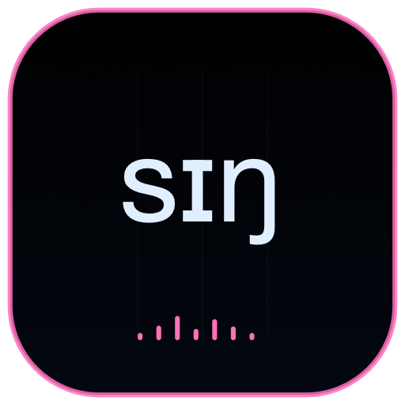

<p align="center">
  
</p>

<h1 align="center">CHIMERA SING</h1>

<p align="center">
  
  
  
</p>

Sing is the remote lyric and melody editor for CHIMERA Head. Head performs all song, note-on and note-off planning through the existing Rust engine APIs.

## Features

- Real piano-roll selection, addition, deletion, movement and resizing.
- MIDI pitch, start and duration per note, with one validated engine syllable per note.
- Explicit errors for missing or ambiguous lyrics; no silent fallback to an empty note.
- Existing song presets, edited-score playback, tempo and vibrato controls.
- Shared CoreMIDI and on-screen piano input for successive lyric syllables.
- Ollama lyric prompts remain instructions only; validated generated English enters the score.
- Head-clock playhead, current note/syllable and real gate/output telemetry.
- Shared gestural score, layered spectrogram and expandable acoustic views.

New playback stops the old song first. Pending replacement requests coalesce, and a reconnecting controller recovers the current Head score and playhead.

## Identity

| Setting | Value |
|---|---|
| Scheme / product | `ChimeraSing` / Chimera Sing |
| Bundle ID | `org.chimera.sing` |
| MCP | `http://127.0.0.1:8645/mcp` |
| Audio host | Chimera Head on port 8647 |

## Run

```sh
cd native
xcodegen generate
DEVELOPER_DIR=/Applications/Xcode.app/Contents/Developer xcodebuild -project ChimeraMac.xcodeproj -scheme ChimeraSing -configuration Release -derivedDataPath build
open build/Build/Products/Release/Chimera\ Head.app
open build/Build/Products/Release/Chimera\ Sing.app
```

`chimera_sing` supports set/play/generate/stop and note-on/note-off. `chimera_stop_singing` stops only the current song.

[Project license](../../../../LICENSE) · [Main project](../../../../README.md)
