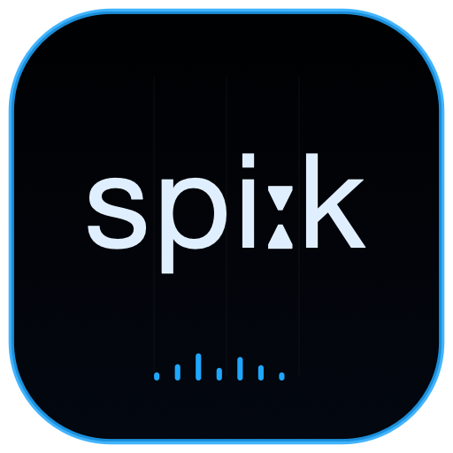

<p align="center">
  
</p>

<h1 align="center">CHIMERA SPEAK</h1>

<p align="center">
  
  
  
</p>

Speak is an Ollama prompt chat whose generated English replies are spoken by CHIMERA Head. User prompts are never spoken.

## Features

- Local Ollama model selection and plain-English validation.
- New submissions stop previous generation and speech.
- A Play button on every assistant reply replays only that generated text.
- Stop cancels generation/speech; Clear resets the conversation.
- Shared gestural score, layered two-second spectrogram and expandable Tube/Vocal Folds.
- Direct English or IPA through the non-chat MCP API.

Ollama must be running on `127.0.0.1:11434`. Head owns the only audio engine.

## Identity

| Setting | Value |
|---|---|
| Scheme / product | `ChimeraSpeak` / Chimera Speak |
| Bundle ID | `org.chimera.speak` |
| MCP | `http://127.0.0.1:8644/mcp` |
| Audio host | Chimera Head on port 8647 |

## Run

```sh
cd native
xcodegen generate
DEVELOPER_DIR=/Applications/Xcode.app/Contents/Developer xcodebuild -project ChimeraMac.xcodeproj -scheme ChimeraSpeak -configuration Release -derivedDataPath build
open build/Build/Products/Release/Chimera\ Head.app
open build/Build/Products/Release/Chimera\ Speak.app
```

The MCP endpoint exposes status, speech, generated speech, stop-speech and stop-all operations.

[Project license](../../../../LICENSE) · [Main project](../../../../README.md)
