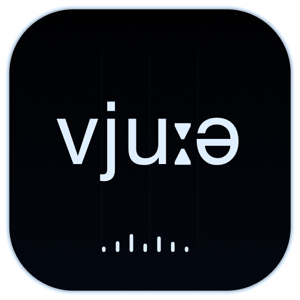

<p align="center">
  
</p>

<h1 align="center">CHIMERA VIEWER</h1>

<p align="center">
  
  
  
</p>

Viewer is the pure remote acoustic and articulatory display for CHIMERA Head. It owns the full consonant chart so the other controllers do not duplicate it.

## Features

- Shared gestural score with live Head-clock playhead.
- Full consonant chart with interactive vowel-context playback.
- Tube area function and pressure visualization.
- Vocal-fold area and flow visualization.
- Layered two-second spectrogram: newest amber trace in front, older traces receding up/right.
- Automatic NDJSON reconnection without polling MCP for telemetry.

Viewer does not create an audio output or render another 3D head.

## Identity

| Setting | Value |
|---|---|
| Scheme / product | `ChimeraViewer` / Chimera Viewer |
| Bundle ID | `org.chimera.viewer` |
| MCP | `http://127.0.0.1:8649/mcp` |
| Audio host | Chimera Head on port 8647 |

## Run

```sh
cd native
xcodegen generate
DEVELOPER_DIR=/Applications/Xcode.app/Contents/Developer xcodebuild -project ChimeraMac.xcodeproj -scheme ChimeraViewer -configuration Release -derivedDataPath build
open build/Build/Products/Release/Chimera\ Head.app
open build/Build/Products/Release/Chimera\ Viewer.app
```

The local MCP endpoint exposes shared status and speech/consonant controls. Live acoustic data comes from Head's NDJSON stream.

[Project license](../../../../LICENSE) · [Main project](../../../../README.md)
